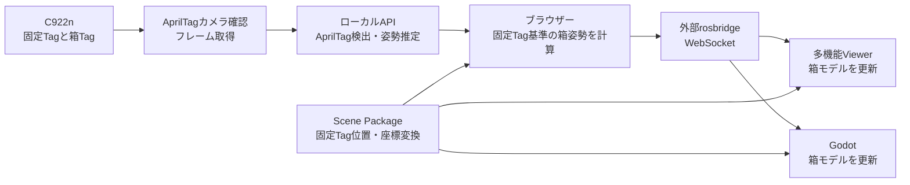

# AprilTagによる物体の位置同期仕様

## 1. 対象と目的

本書は「20260817 DXPO Viewer + AprilTag確認（軽量版）」の、カメラ画像から多機能Viewerへ箱の位置・姿勢を反映する仕様を記載する。対象Scene Packageは `20260817_DXPO-fixed-rig-spzv4-495a985dfdf1`、想定するライブカメラはLogicool C922nである。

静止した3DGS空間の上に、移動する箱を別のモデルとして重ねて表示する。位置・姿勢は6自由度（3次元の位置と回転）で扱い、長さの単位はメートルとする。シンプルViewerは動的箱を表示しない。

GodotはWeb Viewerと同じ受信・表示側として接続する構成である。Godot向け実装仕様は第7節に記載する。

本書は**現行実装の契約**と、明示的に「将来案・未実装」と記した改善案を区別する。現行契約でGodot側の試作は可能だが、実機での安定運用や受け入れの完了を意味しない。未決の性能基準や未実装機能は第8節・第9節を参照する。

## 2. 構成とデータの流れ



アプリは既定で `http://localhost:8080/` を使用し、`/api/apriltag-detect` をVite経由で内部APIへ転送する。rosbridgeは配布版に同梱されず、別途用意する。ローカルで両方の画面を使う場合のURL例は `ws://127.0.0.1:9090` である。両画面から同じrosbridgeへ接続する。

本書の対象はブラウザー画面間の位置表示である。ロボットへの動作指令や安全停止の仕組みは含まない。

## 3. タグとシーンの契約

| 項目 | 対象Scene Packageでの値 |
| --- | --- |
| タグfamily | `tag25h9` |
| 固定Tag | ID 0、辺長 0.1 m |
| 箱Tagの初期対応 | ID 20 → `box_01`、ID 21 → `box_02`、ID 22 → `box_03`、ID 23 → `box_04` |
| タグ寸法 | 固定Tagと箱Tagに共通の値を使用 |
| 箱の初期寸法 | 幅 0.5 m、奥行 0.4 m、高さ 0.3 m |
| 初期貼付面 | 上面 |

固定Tag IDは0～9から選択する設計だが、このScene Packageに登録されているのはID 0である。`tag25h9` のIDは0～34のため、箱には20～34を使う。現行の設定検証は20以上のみを確認し、34を超えるIDを拒否しない。35以上を設定してもこのfamilyでは検出できない。

箱Tag IDと箱IDは一対一で対応付ける。運用上の箱IDは `box_01`、`box_02` のように、1～9を2桁、それ以降を先頭ゼロなしとし、送信側・受信側・設定表で文字列を完全一致させる。現行実装は `box_1` と `box_01` を正規化せず、別物として扱う。同じ文字列の重複は設定内で拒否されるが、別表記が同じ実物を指すことは自動検知されないため、運用で管理する。

タグの辺長は、黒白の境界にある検出四隅の間を測る。白い余白を含む紙全体の寸法ではない。印刷後に測定し、白い余白を残して平らに貼る。箱の中心への変換は、タグが指定面の**中央**にある前提である。タグの実寸と設定値が異なると姿勢の並進成分に誤差が生じる。

### 箱とタグの取付方向

箱中心を原点とする箱座標 `B` は、幅方向を `+X`（右）、高さ方向を `+Y`（上）、奥行方向を `+Z`（前）と定義する。前・右は実物に印を付けて管理し、Godotの箱モデルも同じ軸と中心に合わせる。`+Z` を前とするのはこの箱の契約であり、Godotカメラの前方向とは別である。

タグ座標 `M` は検出中心を原点とし、正立したタグ画像を表側から見て `+X` が右、`+Y` が上、`+Z` が表側への法線である。正立方向は[公式タグ画像](https://github.com/AprilRobotics/apriltag-imgs)を回転させずに見た向きとする。タグは回転してもIDを認識できるため、印刷時に画像の上辺を紙または箱に明示する。検出器の `+Y` 下・`+Z` タグ内向きという座標から送信処理で変換する。

現行実装が想定する取付位置と向きは次のとおり。数値は箱座標で表し、`w / h / d` は幅・高さ・奥行である。`+Y_M` は正立画像の上辺方向、`+Z_M` は表側への法線を示す。

| 貼付面 | タグ中心の箱座標 | `+X_M` の向き | `+Y_M`（画像上辺）の向き | `+Z_M` の向き |
| --- | --- | --- | --- | --- |
| 上面 top | `[0, h/2, 0]` | `+X_B` | `-Z_B`（後ろ） | `+Y_B` |
| 底面 bottom | `[0, -h/2, 0]` | `+X_B` | `+Z_B`（前） | `-Y_B` |
| 前面 front | `[0, 0, d/2]` | `+X_B` | `+Y_B`（上） | `+Z_B` |
| 後面 back | `[0, 0, -d/2]` | `-X_B` | `+Y_B`（上） | `-Z_B` |
| 右面 right | `[w/2, 0, 0]` | `-Z_B` | `+Y_B`（上） | `+X_B` |
| 左面 left | `[-w/2, 0, 0]` | `+Z_B` | `+Y_B`（上） | `-X_B` |

例えば上面では画像の上辺を箱の後ろに向ける。現行UIは面と箱寸法を設定するが、面内の回転や中心からのずれを設定できない。この向きから90°回して貼ると箱の姿勢がずれるため、正しい向きに貼り直す。任意の取付姿勢の補正は将来案であり第5節を参照。

固定Tag 0はScene Package作成時の実空間上の位置・向きに置く必要がある。登録座標は [fixed_tag_map.json](../web_viewer/app/public/scene_package/runtime/20260817_DXPO-fixed-rig-spzv4-495a985dfdf1/annotations/fixed_tag_map.json) にあり、位置は約 `[-1.950, -0.059, 3.836]` m、回転は `xyzw` 順で保存されている。元の配置と異なる場所で試す場合、タグ間の相対的な動きは確認できても、背景の実設備との重なりは保証されない。正しい位置合わせには、その現場の固定Tagを測定・登録したScene Packageが必要である。

## 4. カメラ入力とAprilTag検出

1. ブラウザーはC922nから映像を取得する。実装は1280×720・60 fpsを理想値として要求するが、実際の解像度・fpsはブラウザーとカメラの交渉結果に従う。
2. 初期の認識処理幅は960 px。640 px、1280 px、カメラ解像度のままにも変更できる。フレームをJPEGにしてAPIへ送る。
3. APIは `pupil-apriltags` で選択familyのID、四隅、カメラ座標に対する姿勢を推定する。入力画像は処理後に破棄し、通常の検出処理では保存しない。
4. カメラ座標は `+X: 画像右、+Y: 画像下、+Z: カメラ前方`。送信用処理では、検出器のタグ座標とアプリのタグ座標の向きの違いを補正する。

カメラ確認画面は複数familyの単独検出に対応するが、Viewerへの箱の送信は現在 `tag25h9` に限定する。検出器には補助的な画像追跡があるが、画像追跡だけによる未再認識の姿勢はViewerへ送信しない。

### C922nの内部パラメータ

| 方法 | 仕様 |
| --- | --- |
| 水平画角から概算 | 初期値60°。画面の幅から焦点距離を概算し、主点を画像中心とする |
| 手入力 | `fx / fy / cx / cy` を入力し、処理解像度へ換算する |
| 校正JSON | 実測した内部パラメータとOpenCV形式の歪み係数を使用する |

C922nのメーカー公称は1080p/30 fps、720p/60 fps、**対角画角78°**である。対角画角を水平画角の欄へそのまま入力しない。16:9・切り出しなし・ピンホールモデルを仮定した水平画角は約70.4°であり、初期値60°とは異なる。同じ画像幅で計算した焦点距離は60°の仮定の方が約22%大きくなる。いずれも実測校正値ではなく、値の差をそのまま位置誤差率とみなすことはできない。

簡易表示の動作確認では60°初期値などの概算を使用できるが、精度評価では実カメラの校正JSONを使用し、実際の撮影解像度・縦横比・画角の切り出し・ズーム・フォーカス条件を校正時と一致させる。タグ辺長も印刷後に実測して入力する。条件が変わった場合は校正を見直し、実際に交渉された撮影条件を記録する。

校正JSONの必須項目は、`schema_version: spatial_camera_calibration_v1`、撮影画像の `width / height`、`fx / fy / cx / cy`、歪みモデル `opencv_plumb_bob` と4・5・8個の係数、カメラの `model`、ISO 8601形式の `calibrated_at` である。校正画像と解析画像の縦横比が1%を超えて異なる場合は拒否する。詳細な型と検証は [CameraCalibration.ts](../web_viewer/app/src/preview/CameraCalibration.ts) に定義する。

## 5. 位置・姿勢の計算

`T_A_B` を「B座標の点をA座標へ変換する姿勢」とする。カメラ画像から、同じフレームに写った固定Tag `F` と箱Tag `M` の姿勢 `T_C_F`、`T_C_M` を推定する。タグ座標の向きを正規化した後、箱中心 `B` の固定Tagに対する姿勢を次で求める。

```text
T_F_B = inverse(T_C_F) × T_C_M × T_M_B
```

`T_B_M` は箱座標におけるタグの取付位置・姿勢であり、第3節の表が現行の6自由度の取付契約である。送信処理が使うのはその逆変換 `T_M_B = inverse(T_B_M)` である。例えば上面の初期寸法では `T_B_M` の並進は `[0, 0.15, 0]` m、回転は `[-0.70710678, 0, 0, 0.70710678]`（`xyzw`）。現行の計算値は [boxTrackingInTagPose](../web_viewer/app/src/preview/AprilTagViewerBridge.ts) を参照する。

**将来案・未実装:** 面内の90°回転や中心からのずれを扱う場合は、実測した `T_B_M` を6自由度で設定し、その逆を送信側で使用する設計とする。校正方法・保存形式・検証条件は未決であり、現行の面指定のみで任意取付を補正することはできない。

Viewerは受信した相対姿勢をScene PackageのROS↔Viewer座標変換で変換し、登録済み固定Tagのワールド姿勢に合成する。

```text
T_world_B = T_world_F × T_viewer_ros × T_ros_F_B × inverse(T_viewer_ros)
```

本PackageのROS座標は右手系の `X前方・Y左・Z上`、Viewer座標は右手系の `X右・Y上・Z後方`。変換 `T_viewer_ros` の並進は `[0, 0, 0]`、回転クォータニオンは `[-0.5, 0.5, 0.5, 0.5]`（`xyzw` 順）である。変換は [scene_manifest.json](../web_viewer/app/public/scene_package/runtime/20260817_DXPO-fixed-rig-spzv4-495a985dfdf1/scene_manifest.json) の設定を使い、画面側で固定値を推測しない。

カメラを動かしても、固定Tagと箱Tagを同じ画像で正しく検出できれば、両者の相対姿勢を計算できる。これはカメラ校正や検出誤差が消えることを意味しない。

## 6. ROS通信と採否

| 項目 | 仕様 |
| --- | --- |
| トランスポート | ブラウザーからrosbridgeへのWebSocket |
| topic | `/box/relative_transform` |
| メッセージ型 | `geometry_msgs/msg/TransformStamped` |
| `header.frame_id` | 固定Tagのframe名。対象Packageでは `apriltag_tag25h9_0` |
| `child_frame_id` | `box_01` などの箱ID |
| `transform` | 固定Tagに対する箱中心の並進と回転。並進はm、回転は `xyzw` |
| 時刻 | 画像取得時刻を可能な範囲で使用し、ROS形式の秒・ナノ秒に変換 |

### 接続・配信契約

送信側はWebSocket接続成立後、まず型を明示して次を送る。再接続時も送信し直す。現行コードは既に `advertise` している。

```json
{"op":"advertise","topic":"/box/relative_transform","type":"geometry_msgs/msg/TransformStamped"}
```

受信側は送信側とは独立した接続で、第7.1節の `subscribe` を接続ごとに送る。送信側は自身の `advertise` 後に次の `publish` を送る。事前に型を宣言しているため、この例の `publish` 内に型はない。数値は説明用であり、実機の測定値ではない。

```json
{
  "op": "publish",
  "topic": "/box/relative_transform",
  "msg": {
    "header": {
      "stamp": { "sec": 1700000000, "nanosec": 0 },
      "frame_id": "apriltag_tag25h9_0"
    },
    "child_frame_id": "box_01",
    "transform": {
      "translation": { "x": 0.1, "y": 0.0, "z": 0.0 },
      "rotation": { "x": 0.0, "y": 0.0, "z": 0.0, "w": 1.0 }
    }
  }
}
```

この並進はROSの相対座標であり、その値をViewerのワールド座標として直接使用しない。

外部rosbridgeの製品版・ROS 2ディストリビューション・RMW・QoSは、このアプリに固定されていない。現行送受信は `qos` を明示しないため、実際の既定値・互換性は使用する版の設定を確認する。[rosbridge ROS 2プロトコル](https://github.com/RobotWebTools/rosbridge_suite/blob/ros2/ROSBRIDGE_PROTOCOL.md)の現行文書では `qos` 指定とpublisherの `transient_local` 既定値が記載されているが、すべての配備済みバージョンへの適用は未確認である。同文書には、同一topicで最初のadvertiseが共有publisherのQoSを決める制約もある。

**将来案・未実装:** rosbridge・ROS 2・RMWのバージョンを構成管理で固定し、対応版においてpublisher・subscriber双方の互換性を確認したうえで `durability: volatile` 等のQoSを明示する。現行コードにQoS指定はなく、使用可能な値と指定方法は採用版で確認が必要。`volatile` だけでは通信途中の古いデータの判定はできない。接続順序、再接続、送信停止後の新規購読を第8節で試験する。

### 送信元とScene Packageの運用条件

現行メッセージには送信元・セッション・Scene Packageの識別子がない。現行の運用条件として、同一rosbridge・topicでは送信側を同時に1つだけ稼働させ、送受信側で同じScene Package ID・固定Tag map・箱ID対応を事前に照合する。共有環境で別の送信が混在し得る場合は、試験用rosbridgeやネットワーク・ROS domainを分離する。受信側は現行メッセージだけでは別送信元や別Packageを検出・拒否できず、フレーム名の一致だけでは同じ座標系と証明できない。

**将来案・未実装:** 複数送信元を扱う場合は、送信元ID・セッションID・Scene Package IDと姿勢との対応を含むバージョン付きメッセージ等を新たに定義し、両受信側で照合・拒否する。現行の `TransformStamped` に独自フィールドを追加する方法はROS型の互換性を保証しないため採用しない。

送信には、固定Tagと対象箱Tagの**同一フレームでの確定検出**、姿勢の存在、`hamming = 0`、設定されたdecision margin以上が必要である。画面のmargin初期値は10。検出器自体もmargin 10未満を除外するため、送信側で10未満に設定してもその値未満の検出は得られない。

### 受信側の検証・鮮度・状態

Web Viewerと同等の受信動作にする場合、箱ごとに最後の採用姿勢、送信元時刻、受信時刻を管理する。

1. `op / topic / msg` を確認し、JSONや必要な型・要素が不正なメッセージを破棄する。
2. `frame_id` が固定Tag mapに存在し、`child_frame_id` が `box_01`、`box_2` など `^box_0*[1-9][0-9]*$` に一致することを確認する。実行時の箱IDは最大64件。
3. 並進とクォータニオンの全要素が有限で、回転の長さが0でなく、`abs(norm - 1) <= 1e-6` であることを確認する。入力の不正な回転を黙って正規化しない。Godotのクォータニオンは既定で32-bit精度なので、境界の検証はJSONの数値を使って行う。
4. `sec` と `nanosec` が非負の整数値、`nanosec < 1000000000` であることを確認し、送信元時刻を箱ごとに比較する。GodotのJSON解析は数値をfloatとして扱うため、型がintかどうかではなく整数値かを検証する。Web Viewerは `sec * 1000 + nanosec / 1000000` をミリ秒として比較し、同じ時刻または以前の時刻を拒否する。異なる箱同士で時刻を共有しない。
5. 第5節の変換後、直前に採用した同じ箱の姿勢から並進0.5 m超または回転45°超なら拒否する。初回は比較対象がない。これは対象Packageの実行時箱の初期値であり、別Packageで上書きされる場合はその設定に従う。
6. 採用した場合だけ箱姿勢と最終受信時刻を更新する。順序判定に使う送信元時刻と、タイムアウトに使うGodot側の単調増加時刻を混同しない。
7. 対象Packageでは、最後の採用から375 ms超かつ追跡中の場合は更新遅延、500 ms超は追跡喪失として箱を非表示にする。Web Viewerの状態確認周期は約50 ms。Godotでは `Time.get_ticks_msec()` 等の単調増加時計を使える。切断時は箱を非表示にし、再接続時は箱ごとの前回姿勢と時刻をリセットする。

不正・重複・急変として拒否したデータでは、最後に採用した姿勢を上書きしない。タイムアウトによる非表示だけでは最後の採用姿勢は消えないため、再検出位置が急変閾値を超える場合は拒否が続き得る。再接続時に状態をリセットする。

### 時刻と古いデータ

現行の送信元時刻は画像取得に近い時刻を可能な範囲で使うが、ブラウザーが取得時刻を提供しない場合などにはコールバック時刻等を使用する。必ずしも露光時刻ではない。受信側はこの時刻で**箱ごとの順序のみ**を確認し、送信元から受信までの経過時間を検証しない。最後の採用からの500 msは受信停止のタイムアウトであり、到着した姿勢の取得時からの古さの上限ではない。最後に採用した姿勢より送信元時刻が新しければ、遅延して届いた姿勢でも採用される可能性がある。

**将来案・未実装:** 撮影側と受信側の時計の同期精度・時刻の意味・許容時計ずれ・最大データ年齢を決め、時刻の飛びや送信元再起動をセッション単位で扱ってから鮮度を判定する。未同期の別PCの時刻を単純に引き算しない。現在は鮮度上限・許容ずれとも未決であり、通信や画像処理の遅延・fpsも保証していない。

### 追跡喪失後の復帰

現行では喪失によって姿勢を自動初期化しない。喪失中に箱を0.5 m超移動または45°超回転させた場合、再検出後も古い姿勢との急変判定で拒否が続くことがある。運用上の復帰手順は、対象の受信画面でいったんrosbridgeを切断し、再接続して前回姿勢と時刻をリセットすること。再接続後の初回姿勢は急変比較なしで採用されるため、表示位置を目視で確認する。Web ViewerとGodotはそれぞれ独立に状態を管理し、一方の再接続は他方をリセットしない。Godot側も同じリセット処理を実装する必要がある。

**将来案・未実装:** 喪失後に再捕捉待ち状態へ入り、複数の異なる有効フレームについて位置・回転の相互整合性を確認してから、旧姿勢に対する急変比較を解除し、新しい姿勢を初期採用する。判定中は非表示とし、誤検出や重複フレームでは復帰しない。必要フレーム数、位置・角度の整合閾値、観測時間、時刻・送信元リセット条件は未決であり、Web Viewer・Godot双方で同じ条件を実装して試験する必要がある。

## 7. Godotでの受信・表示

Godotを既存の多機能Web 3DGS Viewerと同じ**受信・表示側**として扱う。想定APIはGodot 4系のGDScript。Godot側はカメラのAprilTagを直接検出せず、既存の「AprilTagカメラ確認」が送信した箱の姿勢をrosbridgeから受信する。

本書は位置同期の受信・変換・表示を実装するための契約であり、完成済みGodotプロジェクトではない。このリポジトリにはGodot用SPZローダーや3DGS描画実装は含まれない。Godotで背景の3DGSも表示する場合は、別途対応する描画方法を選び、下記のScene Packageと同じ位置・尺度・向きになることを確認する必要がある。Godot 4系以外のAPI互換性は未確認。

### 7.1 接続と購読

Godotはカメラ画面およびWeb Viewerと同じrosbridgeに、**別のWebSocketクライアント**として接続する。ROS 2クライアントをGodot内へ組み込むことは、この方法では必須ではない。

- rosbridge URL例: `ws://127.0.0.1:9090`。このIPは**Godotを実行するPC自身**を指す。別PC上のrosbridgeに接続する場合は、そのPCから到達できるホスト名またはIPを設定する。
- topic: `/box/relative_transform`
- 型: `geometry_msgs/msg/TransformStamped`
- 送受信形式: rosbridgeのJSONテキスト。接続後、次の購読要求を1回送る。

```json
{"op":"subscribe","topic":"/box/relative_transform","type":"geometry_msgs/msg/TransformStamped"}
```

Godot 4の `WebSocketPeer` は `connect_to_url()` の後、`_process()` などで `poll()` を継続する。`STATE_OPEN` になってから購読要求を `send_text()` し、受信パケットをJSONとして解析する。再接続時は購読要求を送り直す。切断時は箱を非表示にする。

rosbridgeからは `op = "publish"`、`topic = "/box/relative_transform"`、`msg` にROSメッセージを持つJSONを受け取る。他topicやそれ以外の操作は位置更新として扱わない。通信例は第6節にある。

同じtopicを購読する他のシステムにも送信データが届く。接続先・ネットワーク公開範囲は運用側で決める。ブラウザー上のGodotでは、ページがHTTPSなら接続先にも適切なWSSが必要になる。

### 7.2 箱中心と寸法

送信側ですでに、箱Tagの貼付面と箱寸法を使って**タグ中心から箱中心へ変換済み**である。Godot側で同じ補正を再度かけない。メッセージに箱TagのID、箱寸法、カメラパラメータ、検出品質、Scene Package IDは含まれないため、これらは別途共有・設定する。

実物が第3節の初期設定と異なる場合は、送信側と同じオリジン・同じブラウザーの多機能Viewerで `box_01` の寸法・貼付面を設定する。設定はそのブラウザー内に保存され、Godotへ寸法が自動配信されるわけではない。Godotの箱モデルの寸法も別途合わせる。

箱モデルを `BoxMesh` で表す場合、対応する `size` の順序は `Vector3(幅, 高さ, 奥行)` なので、初期値は `Vector3(0.5, 0.3, 0.4)` となる。原点は箱中心に置く。

### 7.3 Godotの座標と変換

#### 7.3.1 必要なScene Package情報

Git LFSでSPZを取得したうえで、次のファイルを参照する。SPZの有無と固定Tag座標の参照は別の責務である。

- [scene_manifest.json](../web_viewer/app/public/scene_package/runtime/20260817_DXPO-fixed-rig-spzv4-495a985dfdf1/scene_manifest.json): `coordinate_system.T_viewer_ros` と `dynamic_overlay.freshness.timeout_ms`
- [fixed_tag_map.json](../web_viewer/app/public/scene_package/runtime/20260817_DXPO-fixed-rig-spzv4-495a985dfdf1/annotations/fixed_tag_map.json): 固定Tag frameごとのワールド位置・姿勢
- [world_alignment.json](../web_viewer/app/public/scene_package/runtime/20260817_DXPO-fixed-rig-spzv4-495a985dfdf1/config/world_alignment.json): 背景3DGSの生成座標からワールド座標への変換

鮮度閾値は `scene_manifest.json` の正確なキー `dynamic_overlay.freshness.timeout_ms` で、本Packageでは500 ms。更新遅延はこの値の75%（375 ms）である。急変閾値はこのPackageのmanifestに存在せず、[DynamicTrackingContract.ts](../web_viewer/app/src/dynamic/DynamicTrackingContract.ts) の実行時箱の既定値 `max_translation_jump_m = 0.5`、`max_rotation_jump_deg = 45` を使う。別Packageが `annotations.dynamic_objects` で動的物体定義JSONを指定する場合は、そのJSONの `objects[]` 内の同名キーを確認する。本Packageにはその参照がなく、Godot実装で参照元を誤らないこと。

対象Packageはm単位・右手系で、Viewer座標は `X右 / Y上 / Z後方`、ROS座標は `X前方 / Y左 / Z上`。Godotのカメラ座標の慣例も右手系・Y上・カメラ前方が-Zだが、**軸の慣例が同じだけでは、原点・尺度・背景モデルの変換が一致したことにはならない**。

このPackageの固定値は以下。実装は可能ならファイルを読み、別Packageでも値を決め打ちしない。

```text
T_viewer_ros:
  translation_m = [0.0, 0.0, 0.0]
  rotation_xyzw = [-0.5, 0.5, 0.5, 0.5]

T_world_fixedTag (apriltag_tag25h9_0):
  translation_m = [-1.9498016576367234, -0.059395876925607716, 3.836025736474979]
  rotation_xyzw = [-0.004814982222489291, 0.9884368636224934,
                    0.0059825152894984355, -0.1514384102172778]
```

#### 7.3.2 合成順序

`T_A_B` はB座標の点をA座標へ変換する姿勢。ROSメッセージから作った `T_ros_fixed_box` に対し、Web Viewerと同じ変換は次の順序である。

```text
T_viewer_fixed_box = T_viewer_ros × T_ros_fixed_box × inverse(T_viewer_ros)
T_world_box        = T_world_fixedTag × T_viewer_fixed_box
```

上式では、Godot上の背景とScene Packageのワールド座標が同じで、1 Godot単位 = 1 mと仮定する。Godot側のシーンに追加変換がある場合は、別途 `T_godot_world × T_world_box` を適用する。背景の変換に使った尺度や軸変換を箱に二重適用しない。特に、SPZのSpark向けデコード契約とGodot側ローダーの軸変換が一致するかを確認すること。

算出したGodotワールド姿勢は `Node3D.global_transform` に反映する。親ノードに変換がある場合、ワールド姿勢をそのままローカルの `transform` に代入すると親変換が余分にかかる。箱モデル自体の中心・前向きが契約と異なる場合は、そのモデル固有の補正を別途定義する。

#### 7.3.3 変換部分のGDScript例

次は**変換部分だけ**の参考例で、入力検証・受信・タイムアウト処理は含まない。`fixed_pose` と `viewer_from_ros` は上記のPackage値から構築し、受信クォータニオンは先に第6節に従って検証する。この変換関数と第7.4節の3ケースは、Godot 4.4.1のheadless実行で照合済み。

```gdscript
func resolve_world_pose(
        msg: Dictionary,
        fixed_pose: Transform3D,
        viewer_from_ros: Transform3D
) -> Transform3D:
    var translation: Dictionary = msg["transform"]["translation"]
    var rotation: Dictionary = msg["transform"]["rotation"]
    var ros_pose := Transform3D(
        Basis(Quaternion(
            float(rotation["x"]), float(rotation["y"]),
            float(rotation["z"]), float(rotation["w"])
        )),
        Vector3(
            float(translation["x"]), float(translation["y"]),
            float(translation["z"])
        )
    )
    var viewer_relative := viewer_from_ros * ros_pose * viewer_from_ros.affine_inverse()
    return fixed_pose * viewer_relative
```

Godotの `Quaternion` コンストラクターは `Quaternion(x, y, z, w)`。対象Packageの `T_world_fixedTag` は、対応する `rotation_xyzw` を `Basis(Quaternion(...))`、`translation_m` を `Vector3(...)` に渡して `Transform3D` を作る。

### 7.4 実装確認用の数値

以下は **各ケースを前回姿勢なしで独立に実行**した数学テストであり、実カメラの測定値ではない。共通して `frame_id = apriltag_tag25h9_0`、`child_frame_id = box_01`、送信時刻 `sec = 1700000000 / nanosec = 0`、第7.3節の対象Package値を使う。ケースBはAから連続して送ると0.5 mの急変閾値により拒否される。

| ケース | ROS相対並進 `[x,y,z]` m | ROS相対回転 `[x,y,z,w]` | 期待するワールド位置 m |
| --- | --- | --- | --- |
| A | `[0, 0, 0]` | `[0, 0, 0, 1]` | `[-1.94980166, -0.05939588, 3.83602574]` |
| B | `[1, 0, 0]` | `[0, 0, 0, 1]` | `[-1.65036943, -0.06976421, 4.79008697]` |
| C | `[0.25, -0.2, 0.1]` | `[0, 0, 0.7071067812, 0.7071067812]` | `[-2.06653156, 0.03573413, 4.13573295]` |

期待するワールド回転の `xyzw` は、A・Bが `[-0.00481498, 0.98843686, 0.00598252, -0.15143841]`、Cが `[-0.00763498, 0.59184728, 0.00082557, -0.80601354]`。クォータニオンは全要素の符号を反転したものも同じ回転を表す。Godot既定精度では各数値をおおむね `1e-5` の許容差で比較する。

補助確認として、ケースBのROS相対並進 `[1, 0, 0]` は、固定Tagへ合成する前にViewer基底で `[0, 0, -1]` になる。3ケースの期待値はWeb Viewerの変換実装と独立したクォータニオン計算で照合済み。

#### 状態・拒否の受け入れ条件

次はWeb Viewerの実装に対して確認した期待動作。Godot側でも別途試験する。

| 試験 | 期待結果 |
| --- | --- |
| 最初の正常姿勢 | 箱を表示し、姿勢・送信元時刻・受信時刻を記録 |
| 同じ箱・同じ時刻の再送 | 重複として拒否し、姿勢と最終採用時刻を更新しない |
| 別の箱・同じ時刻 | 箱ごとに時刻を管理するため、ほかに問題がなければ採用 |
| 時刻逆行、ゼロ回転、非単位回転 | 拒否し、最後の採用姿勢を上書きしない |
| 同じ箱で1 mの急変、または90°の急回転 | 初期閾値を超えるため拒否 |
| 採用後376 ms経過 | 追跡中なら更新遅延状態。箱はまだ表示 |
| 採用後501 ms経過 | 追跡喪失状態。箱を非表示 |
| 接続し直す | 箱ごとの前回姿勢と送信元時刻をリセット |
| 喪失中に箱を1 m動かして再検出 | 現行は旧姿勢に対する急変として拒否し続け得る。受信側を再接続後、初回姿勢を採用して目視確認 |
| 上面タグを規定から90°回して貼付 | 現行の設定では補正できず、正しい箱姿勢は期待できない。規定方向へ貼り直す |
| 新しい時刻だが遅延して届いた古い姿勢 | 現行は取得からの経過時間を判定しないため採用し得る |
| 同一topicに複数送信元、または異なるPackage | 現行は識別・自動拒否できない。運用で単一送信元・同一Packageを維持する |

### 7.5 Godot実機接続時の確認事項

1. Godot側が実行するPCからrosbridgeに接続し、購読後に `publish` メッセージを受け取れることを確認する。
2. 固定Tag 0と箱Tag 20を同一画像で検出させ、`box_01` が現れることを確認する。
3. 実測した箱の寸法・貼付面と送信側の設定を一致させる。Godot側のモデル表示寸法も同じにする。
4. 固定TagがScene Package作成時の実位置・向きにある場合に、Web ViewerとGodotの箱位置・回転を同条件で比較する。
5. タグを隠して送信を止め、約500 ms後に箱が消えることを確認する。異常値、時刻逆行、急変、切断・再接続も個別に試す。

Godot 4.4.1のheadless実行では、本仕様を基に一時的な受信コードを作成し、ネットワークを分離した模擬rosbridgeとの購読・メッセージ受信を確認した。第7.4節の3ケース、箱ごとの時刻管理、不正値・急変の拒否、鮮度判定、状態のリセットも合成データで確認済みである。

さらに、外部ネットワークとホストポートを使わない隔離環境で、実際のROS 2 rosbridgeに合成した `TransformStamped` を送信し、Godotが第7.4節の3ケースを受信・変換することを確認した。いずれの受信コードも検証用であり、本リポジトリには完成実装として含まれない。

実カメラ・実タグからの送信、実際の配備環境でのGodotとの相互接続、GodotでのSPZ表示は未検証である。本書は受信側を実装・試験するための仕様であり、実機連携完了の証明ではない。

## 8. 試験手順

1. C922nをブラウザーを使うPCに接続する。固定Tag 0と箱Tag 20を同時に見える位置へ置く。
2. 外部rosbridgeを起動し、Viewerとカメラ画面の両方からアクセスできることを確認する。すでに共有rosbridgeが稼働している場合、同じtopicを購読する他の画面にも試験データが届く。
3. [多機能Viewer](http://localhost:8080/?scene_package=20260817_DXPO-fixed-rig-spzv4-495a985dfdf1&viewer=full)を開き、「動的追跡」のrosbridge URLを確認して「接続」を押す。
4. 同じブラウザー・同じオリジンの別タブで `http://localhost:8080/` の「AprilTagカメラ確認」を開く。C922n、`tag25h9`、0.1 m、固定ID 0、箱ID 20 → `box_01` を設定し、カメラとrosbridgeを接続する。
5. 両タグの同時検出と「送信中」を確認し、Viewerに箱が現れることを確認する。Viewerで `box_01` を選び、実際の寸法と貼付面を適用する。設定は同じブラウザーのローカル保存領域を介して送信画面へ反映される。
6. 箱を小さくゆっくり移動・回転し、Viewerの追従を確認する。固定Tag中心から箱中心までの実測距離とViewerの距離表示を比較する。画像認識だけで追従が保証されるわけではないため、照明、画角、遮蔽、処理速度、校正の影響を確認する。

### 実機受け入れの測定計画と未決の基準

実機の合否に使う数値は**未決**であり、下表は計測・合意のための項目である。測定値、要求値、試験条件が揃うまで、実機受け入れは判定しない。位置・角度は基準器や治具の精度と不確かさも記録する。

| 項目 | 測定方法 | 合否基準 |
| --- | --- | --- |
| 位置精度 | 同じワールド座標上の基準姿勢と表示箱中心の差のユークリッド距離をmで記録。カメラからの距離・角度・画面位置を複数条件で変える | 最大値または95パーセンタイルの許容m数は未決 |
| 角度精度 | 実物の基準姿勢と表示姿勢の回転差の最小角を度で記録。クォータニオンの符号反転は同一回転として扱う | 最大値または95パーセンタイルの許容度数は未決 |
| 遅延 | 観測開始と画面表示反映を同一時計または同期・誤差を検証した計測系で測り、どの区間の遅延か明記する。必要なら高速撮影等で実物動作から表示までを測る | 対象区間、統計方法、許容ms数は未決 |
| 更新頻度 | 受信側で実際に採用した姿勢更新回数を測定時間で割る。拒否・欠落や停止期間も記録する | 測定期間・最低Hzは未決 |

試験前に、対象距離・角度・照明、タグ寸法、カメラ撮影条件、校正、サンプル数・測定時間、基準器、各合否閾値を関係者で決めて記録する。カメラフレームfps、API処理fps、姿勢送信fps、受信採用fpsは異なり得るので、測定対象を区別する。

追加試験では、接続順序・切断後再接続・送信停止後に受信側が購読開始する場合、遅延データ、複数送信元、異なるPackage、規定から90°回転したタグ、追跡喪失中に1 m動かした箱をそれぞれ確認する。現行の期待結果と制約は第7.4節の表に従う。将来案の自動再捕捉・識別・鮮度拒否・任意取付補正は、実装と条件合意の後に別途合否判定する。

実際のカメラとタグ、距離を記録した比較試験は未実施であり、精度・遅延・更新頻度の保証値はない。

## 9. 現在の制約

- `custom` 配布版では「同じ画面でScene Package Viewerを開く」ボタンの遷移先にAprilTag画面が復帰しないことを確認した。位置同期の試験には別タブを使用する。
- 固定Tagまたは箱Tagが見えない、検出品質が不足する、送受信が止まる場合は更新されず、タイムアウト後に箱が消える。
- 同じブラウザーの同じオリジンで箱の寸法・貼付面設定を共有する。別PCや別ブラウザーへ自動共有はされない。
- このPackageのProxy関連機能は無効で、箱の描画は奥行きテストを使わない。背景の手前・奥の遮蔽を現実どおり再現する機能は対象外である。
- タグの貼り付けずれ、カメラ歪み、印刷寸法、照明、動きによるぼけ、通信遅延によって誤差が生じる。カメラ画面の見た目の平滑化と、Viewerへ送る確定姿勢は別である。

## 10. 実装・参照先

- カメラ画面・送信: [AprilTagLiveCheck.ts](../web_viewer/app/src/preview/AprilTagLiveCheck.ts)、[AprilTagViewerBridge.ts](../web_viewer/app/src/preview/AprilTagViewerBridge.ts)
- 検出処理: [apriltag_live_detection.py](../generation_pipeline/tools/apriltag_live_detection.py)
- 受信・座標変換・鮮度: [DynamicTrackingContract.ts](../web_viewer/app/src/dynamic/DynamicTrackingContract.ts)、[RosbridgeTransformClient.ts](../web_viewer/app/src/dynamic/RosbridgeTransformClient.ts)
- 物体描画: [DynamicObjectLayer.ts](../web_viewer/app/src/dynamic/DynamicObjectLayer.ts)
- 座標契約: [coordinate_system.md](../scene_spec/coordinate_system.md)
- C922n仕様: [Logicool公式](https://www.logicool.co.jp/ja-jp/shop/p/c922-pro-stream-webcam)
- タグ画像・寸法: [AprilRobotics tag25h9画像](https://github.com/AprilRobotics/apriltag-imgs)、[AprilTag pose estimation](https://github.com/AprilRobotics/apriltag#pose-estimation)
- [Godot WebSocketPeer](https://docs.godotengine.org/en/stable/classes/class_websocketpeer.html)、[Transform3D](https://docs.godotengine.org/en/stable/classes/class_transform3d.html)、[Node3D](https://docs.godotengine.org/en/stable/classes/class_node3d.html)
- [Godot JSON](https://docs.godotengine.org/en/stable/classes/class_json.html)、[Godot Time](https://docs.godotengine.org/en/stable/classes/class_time.html)
- 送信プロトコル: [RosbridgeTransformPublisher.ts](../web_viewer/app/src/dynamic/RosbridgeTransformPublisher.ts)、[rosbridge ROS 2プロトコル](https://github.com/RobotWebTools/rosbridge_suite/blob/ros2/ROSBRIDGE_PROTOCOL.md)
- タグ座標: [AprilTag公式の座標系](https://github.com/AprilRobotics/apriltag#coordinate-system)、[tag25h9のID数](https://github.com/AprilRobotics/apriltag/blob/master/tag25h9.c)
- rosbridge: [RobotWebTools rosbridge_suite](https://github.com/RobotWebTools/rosbridge_suite)
